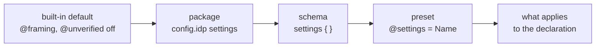

# Settings

**Settings** are package/schema-wide *authoring policy* — "only this
annotation here," "no validator overrides there" — enforced as a hard build
error, not a style suggestion. They come in three layered forms, and in one
cross-package form that adopts another package's policy wholesale.

## Package-wide default — `.idp`

Every package has a `settings` field in its manifest (`config.idp`). A
package that writes none still gets [Comline's built-in
default](#the-built-in-default) — this is the base every schema layers on
top of.

```idp linenums="1"
congregation acme
specification_version = 1

settings = {
    annotations = {
        framing = {
            allowed = true
        }
    }
}
```

`.idp` has no dotted-key sugar (that's `.ids`-only, see below) — nested keys
need real braces, as above.

## Schema-wide — unnamed `.ids` block

A schema file can have one **unnamed** `settings {}` block, applying
implicitly to just that file, layered on top of the package default:

```ids linenums="1"
settings {
    validators.allowed = false
}
```

`.ids` *does* support dotted-key sugar — `validators.allowed = false` desugars
to the same nested shape `.idp`'s `validators = { allowed = false }` would
produce.

## Named presets — `@settings`

A schema file can also have any number of **named** `settings Name {}`
blocks. These are not auto-applied — they are reusable presets, opted into
per-declaration with `@settings = Name`, the same annotation mechanism that
attaches `@validators` or `@framing`:

```ids linenums="1"
settings Strict {
    validators.mode = replace
    validators.allowed = true
}

@settings = Strict
struct Payment {
    amount: u64
}
```

## How the layers compose

For any one declaration, the layers merge in order, each one overriding what
came before it, recursively, key by key:



The [built-in default](#the-built-in-default) is the base; a package's
`settings` in `config.idp` goes on top of it, then the schema's own unnamed
block, then a named preset if the declaration uses `@settings`.

**Merge is the default**; a subtree can opt out with the reserved bare
keyword `mode = replace`, which drops the layer below entirely instead of
merging into it:

```ids linenums="1"
settings {
    validators = {
        mode = replace
        allowed = true
    }
}
```

## Keys

Each key has a declared shape, and a value whose type the key decides. Most
are permission toggles taking a boolean (`true` / `false`):

```
[<decl-path>.]<category>[.<name>].allowed = bool
```

- `<decl-path>` mirrors real schema nesting (`struct.field`, `protocol`,
  `error.field`) and is omittable for a global toggle.
- `<category>` is `annotations` or `validators`.
- `<name>` optionally narrows to one member of that category — an
  annotation's name, or a validator's name.

Three keys are not permission toggles, so not every key ends in `.allowed`
and not every value is a boolean:

| Key | Value |
|---|---|
| `bounds.<name>.max` | a positive integer; see [Default maximums](#default-maximums) |
| `diagnostics."<code>".level` | one of `allow`, `hint`, `info`, `warn`, `error` |
| `mode` | the bare keyword `replace` |

`diagnostics."<code>".level` overrides a diagnostic code's severity
project-wide — `allow` silences it. The code must be quoted, since it
contains `::`. `mode` is legal in any dictionary at any depth and controls
whether that subtree replaces the layer below it instead of merging into
it.

A value of the wrong type is a build error, whether or not anything reads
the key. So is a key that is unrecognised *within* a group Comline owns
(`annotations.`, `validators.`, `diagnostics.`) — `annotations.framing.alowed`
is reported with a suggestion rather than silently doing nothing. An
unrecognised key at the top level stays legal, as an extension point.

A more specific key always wins over a less specific one. For an annotation,
the lookup order is decl-scoped then global:
`<decl-path>.annotations.<name>.allowed` → `annotations.<name>.allowed`. For a
validator reference, the specific name wins over the coarse "any validator"
form at each scope:
`<decl-path>.validators.<name>.allowed` → `<decl-path>.validators.allowed` →
`validators.<name>.allowed` → `validators.allowed`.

Examples:

| Key | Meaning |
|---|---|
| `validators.allowed` | validators usable anywhere |
| `struct.field.validators.allowed` | validators usable on struct fields specifically |
| `protocol.annotations.framing.allowed` | `@framing` usable on protocols |
| `validators.StringBounds.allowed` | kill one validator kind everywhere |
| `diagnostics."validation::deprecated-type-usage".level` | silence or escalate one diagnostic |

No key at any level means **allowed**, with one named exception — see below.

## Default maximums

Every string and dynamic array needs a [maximum](types.md#bounds). Where a type
writes none, the `bounds.<name>.max` settings supply one:

| Key | Default for | Unit | Range |
|---|---|---|---|
| `bounds.string.max` | a `string`, or `char[]` | characters (Unicode scalar values) | 1 to 4294967295 |
| `bounds.array.max` | a dynamic array, `T[]` | items | 1 to 4294967295 |
| `bounds.depth.max` | a struct that can contain itself, with no [`@max_depth`](annotations.md#max_depth) | levels of nesting | at least 1 |

```idp linenums="1"
settings = {
    bounds = {
        string = { max = 256 }
        array = { max = 1024 }
        depth = { max = 16 }
    }
}
```

In a `.ids` file the same is `bounds.string.max = 256`.

- **There is no built-in default.** A package that sets none must write a maximum
  at every string and list, or give bounded size up with
  [`@unverified`](protocol.md#giving-up-a-guarantee). Any other name under
  `bounds.` (`bounds.bytes.max`) is an unrecognised key, and `0` or a
  non-integer is a build error.
- **A maximum written in the type wins.** `char[max 8]` stays 8 under any default.
- **It layers like any setting:** package, then schema, then a `@settings`
  preset. A key scoped to a position goes before the global one:
  `struct.field.bounds.string.max`, `error.field.bounds.array.max`,
  `protocol.function.bounds.string.max` (arguments and returns), and
  `struct.bounds.depth.max`.
  Aliases and validator properties take the global key only.
- **A default is stored resolved** at each position it reaches, so the frozen
  schema says what every position holds, and changing a default changes the
  type wherever it lands, a breaking change for the package.
- **It reaches only this package's positions.** A dependency's types keep the
  maxima resolved in the dependency; a consumer's default doesn't loosen or
  tighten them.

```ids linenums="1"
settings {
    bounds.string.max = 64
}

settings Long {
    bounds.string.max = 4096
}

struct Post {
    title: string           // 64
    @settings = Long
    body: string            // 4096
}
```

## Enforcement

A forbidden annotation or validator reference is always a **hard build
error** naming the annotation/validator and the exact key that forbade it —
there is no `severity = "warn"` escape hatch. This also surfaces live in the
language server, not just at `comline check`/`build` time.

```
error: annotation '@framing' is forbidden here by 'annotations.framing.allowed = false'
  ...
  Help: remove '@framing', or set 'annotations.framing.allowed = true' to allow it
```

## The built-in default

Comline ships one built-in default policy: **`@framing` and `@unverified`
are forbidden until some level explicitly allows them.** Wire framing
(`jsonrpc` vs. `datagram`) is a wire-compatibility decision an organization
should make deliberately once, not something any individual protocol can
silently flip; [giving up a guarantee](protocol.md#giving-up-a-guarantee)
peers rely on is the same kind of decision.

It is the base layer every package starts from, whether or not the package
writes a `settings` block of its own: writing an unrelated setting does not
drop it. A package that genuinely wants no built-in policy can
drop the layer with `mode = replace` at the root, the same escape hatch any
other layer has.

Every other annotation and validator stays allowed by default. Write
`settings = { annotations = { framing = { allowed = true } } }` (or a
decl-path-scoped form) to permit it.

A dependency's schemas are judged by the dependency's own settings, not the
consumer's: a package that allows `@unverified` for itself doesn't make its
consumers allow it too. They [accept](protocol.md#giving-up-a-guarantee) what
it gives up instead.

## Cross-package sharing

A package's `.idp` can adopt another package's named preset directly as its
own package-wide default, instead of copy-pasting the block:

```idp linenums="1"
settings = shared_types::settings::Strict
```

This resolves `Strict` against the `shared_types` dependency's own schemas
(it must be declared in this package's `dependencies`), and adopts that
block's content wholesale — no further merging against `shared_types`' own
package default. If more than one schema in `shared_types` defines a
`settings Strict {}` block, that's an ambiguity error naming both. The
reference is not transitive: `Strict` itself can't be another cross-package
reference — a referenced preset must be concrete.

## What it produces

Every form freezes to a `Settings` IR unit holding the resolved `key = value`
pairs. It is not diffed, so a settings change alone never bumps the package
version.
