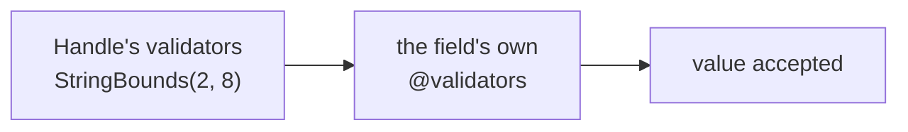

# Validators

!!! note "Run in Rust; TypeScript not yet"
    `comline build` verifies validators: an unknown validator name, a validator
    put on a value of a type it doesn't apply to, a keyword argument that isn't
    a property or whose literal type is wrong, a missing argument for a property
    without a default, or an undeclared `params.*` reference all fail the build. Generated **Rust** code then
    [runs them](#in-generated-code). Generated TypeScript doesn't yet: it
    generates the types without the checks, and `comline generate` warns. See
    [TypeScript's language reference](../../reference/languages/typescript.md#code-generation).

A **validator** is a named, parameterised check you attach to a
[struct](structure.md) or [error](error.md) field, or to a
[`type` alias](#on-a-type-alias).

```ids linenums="1"
/// Checks a string's length is within bounds.
/// @min_chars: minimum length
/// @max_chars: maximum length
validator StringBounds for string {
    min_chars: u32 = 0
    max_chars: u32 = u32::MAX

    validate {
        assert(value.length >= params.min_chars,
               f"{value.name} must be at least {params.min_chars} characters")
        assert(value.length <= params.max_chars,
               f"{value.name} must be at most {params.max_chars} characters")
    }
}
```

## Target types — `for`

Every validator names the type(s) it checks, after `for`. A validator without
`for` is a build error.

```ids
validator StringBounds for string { … }
validator Range for u8, u16, u32 { … }
```

- A field can take a validator only if its type is one of the targets, matched
  exactly: a `u8` field doesn't take a `for u32` validator.
- A [`type` alias](types.md) counts as the type it stands for, so a field of
  type `type Name = string` takes a `for string` validator.
- An `optional` field is checked as its inner type.
- On an array field, a validator checks the **array**, not each element: a
  `for string` validator doesn't go on a `string[]` field.
- Targets are primitives, arrays of them, or aliases. There are no generic
  targets; list each type instead, with one exception: `any[]`.
- **Bounds are ignored when matching.** `for string` applies to every string,
  whatever its maximum (`char[max 32]`, `char[8]`), and `for u32[]` to every
  `u32[max N]`.
- **`any[]`** is a dynamic array of any element type, so one validator can check
  a list's length without naming what it holds. `any` is a keyword only as an
  array's element in a `for`: `any[][]` is a list of lists, and a bare `any`
  is an error. `any[]` doesn't match a string, which is why std's `NonEmpty`
  lists both: `for string, any[]`.

## Properties

`name: Type [= default]`, one per line — the same shape as a
[struct field](structure.md#fields), minus `optional` and annotations. They are
the validator's configuration, supplied where the validator is used.

## `validate`

A `validate` block holds one or more `assert(condition, message)` calls.

- **`condition`** — member paths over `value.*` (the field under check) and
  `params.*` (this validator's properties), compared with `== != >= <= > <` and
  joined by `and` / `or`. `assert(c, m)` passes when `c` is true. Numbers
  compare by value, so a `u8` value against a `u32` property is fine.
- **`value` accessors**:
  - `value` itself;
  - `value.length`, only when every target is `string` or an array. A string's
    length counts characters (Unicode scalar values), not bytes, in every
    language; an array's counts elements.
  - `value.name`, where the value sits, for messages: `handle`, `friends[1]`,
    `author.handle`.

  Anything else is a build error at the validator.
- **`message`** — a string, or an [f-string](error.md#message) whose
  `{value.…}` and `{params.…}` placeholders are substituted. A plain `"..."`
  is printed as written.

Three mistakes build, but warn:

| Warning | When |
|---|---|
| `validation::validator-checks-nothing` | the validator has no `validate` block, or an empty one; shown at the block when there is one |
| `validation::validator-property-unused` | a property no `assert` or message reads |
| `validation::message-not-interpolated` | a plain `"..."` message with a `{...}` in it, which would print as written; the editor's quick fix makes it an f-string |

The condition language is deliberately small and
[non-computational](../../design/validators.md#constraint-stays-non-turing-complete)
— no precedence, no loops, no bindings.

## Using one — `@validators`

Attach validators to a field with the `@validators` annotation: a list of calls
that bind the validator's properties by name.

```ids linenums="1"
struct Message {
    @validators = [StringBounds(min_chars = 3, max_chars = 12)]
    recipient: char[max 64]
}
```

Unbound properties fall back to their declared default; leaving out one without
a default is a build error. A validator with nothing to bind can be written
bare: `@validators = [NonEmpty]` is the same as `[NonEmpty()]`.

Errors' fields take `@validators` too.

A validator from another schema needs a `use`, like a type does (such as
`use std::validators::StringBounds`). Without one it's unknown, and the editor
offers to add the `use`. An imported validator is checked the same way as a
local one: its `for` targets and its arguments, against its declaration.

`@validators` goes on a field or a `type` alias. On a struct, error, protocol or
function there's no single value for it to check, so it's a build error.

## The standard validators

[`std::validators`](../../std/validators.md) ships these. A **maximum** belongs
in the type ([`char[max 32]`](types.md#bounds)), where a decoder checks it before
allocating; validators check what a type can't say, a minimum or a range.

| Validator | For | Checks |
|---|---|---|
| `NonEmpty` | `string`, `any[]` | not empty |
| `MinChars(min)` | `string` | at least `min` characters |
| `MinItems(min)` | `any[]` | at least `min` items |
| `IntRange(min, max)` | `u8` `u16` `u32` `u64` `s8` `s16` `s32` `s64` | the value is within `min` and `max`, both included; each defaults to the type's widest bound |
| `StringBounds(min_chars, max_chars)` | `string` | the length is within both; `max_chars` defaults to no limit. Prefer the type's maximum and `MinChars` |

```ids linenums="1"
use std::validators::{NonEmpty, MinItems, IntRange}

struct Customer {
    @validators = [NonEmpty]
    name: char[max 32]

    @validators = [MinItems(min = 1)]
    orders: Order[max 100]

    @validators = [IntRange(min = 1, max = 12)]
    month: u8
}
```

A std validator's size is checked against the type's maximum at build. A
minimum above it refuses every value, so it is an error: `MinChars(min = 40)`
on a `char[max 32]` (`bounds::validator-minimum-above-maximum`). A cap below it
refuses values the type allows, so it is a warning that suggests moving the cap
into the type (`bounds::validator-caps-below-type`).

## On a type alias

Put `@validators` on a `type` alias to check every value of that alias,
wherever it's used:

```ids linenums="1"
use std::validators::StringBounds

@validators = [StringBounds(min_chars = 2, max_chars = 8)]
type Handle = char[max 32]

struct Account {
    handle: Handle
    friends: Handle[]
}

protocol Accounts {
    function rename(to: Handle) -> Account;
}
```



A value of the alias is checked by the alias's validators first (an alias of
an alias: innermost first), then by the field's own.

- The alias stays the type it stands for: `Handle` is still a `String` in
  generated Rust. Adding a validator never changes a type's API or its wire
  format.
- The validator's `for` target is checked once, against what the alias
  resolves to.
- An alias of an alias collects the checks along the chain.
- An array of the alias (`Handle[]`) checks each element.
- An alias is the only way to check a **function argument**: arguments take no
  annotations of their own, but `to: Handle` runs `Handle`'s checks.

`@deprecated` works on an alias too, and warns wherever the alias is used.

## In generated code

In Rust, every struct, error and function-params struct with something to
check implements `comline_runtime::validation::Validate`. That includes checks
on its own fields, through an alias, or further down in a nested struct or an
array element.

```rust
use comline_runtime::validation::Validate;

account.validate()?;        // Err(ValidationErrors): every failed check
account.validate_first()?;  // Err(ValidationError): the first one
```

Each `ValidationError` carries `field`, the path to the failing value
(`friends[1]`), and `message`, the validator's message with its placeholders
filled in (`friends[1] must be at least 2 characters`). An absent `optional`
field skips its checks.

Nothing calls `validate()` for you unless you ask:
[`validate_on_decode`](../../reference/congregation/comline-toml.md#validate_on_decode)
in `comline.toml` makes decoding run the checks, and makes a provider refuse a
call whose arguments fail them.

Properties are filled in when the code is generated: the argument you wrote,
else the property's default, with constants resolved. Nothing about the
validator exists at run time beyond the checks themselves.
