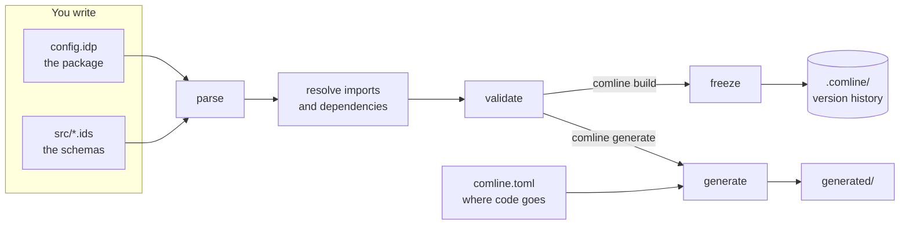

# Guide Overview

Comline takes a schema you write by hand and carries it through a fixed
pipeline. Each stage has its own section in this guide; this page is the map.



`comline check` stops after validating. `comline build` freezes a version;
`comline generate` writes code without freezing anything.

## 1. Write a schema

A package is a directory with a manifest (`config.idp`) and one or more `.ids`
[schema](idl/index.md) files under `src/`:

```
comline new my-api      # scaffold config.idp + comline.toml + src/main.ids
```

A schema declares [structs](idl/structure.md), [enums](idl/enum.md),
[errors](idl/error.md), [constants](idl/const.md),
[type aliases](idl/types.md#type-aliases), [protocols](idl/protocol.md) and
[validators](idl/validator.md), with [docstrings](idl/docstrings.md) on any of
them. [Annotations](idl/annotations.md) and [settings](idl/settings.md) tune
how they're checked and generated.

## 2. Check and build

`comline check` parses, resolves imports and validates. `comline build` does
that and then **freezes** the result into an
[intermediate representation](ir/index.md), stored in the
[content-addressable store](ir/cas.md) under `.comline/` as a new commit in an
append-only chain.

Each build is a pre-release version leading to the next release;
`comline release` creates that version, bumped by the largest change since the
last one. See [Versioning rules](../reference/versioning.md).

## 3. [Generate code](codegen/generating-code.md)

`comline generate` turns the schemas into source for each target language.
The package declares *which* languages it supports, in `config.idp`; whoever
generates decides *where* the code lands, in `comline.toml`
([the two files](codegen/generating-code.md#the-two-files)). One history can be
generated for [several past versions](../design/multi-version-generation.md)
at once.

## 4. [Run it](runtime/index.md)

Generated code links against a runtime library, which runs the handshake,
frames each call and encodes its values: the [call system](runtime/call-system.md).
The [language guides](../languages/index.md) show it in Rust and TypeScript.

## Then

- [Packages & dependencies](packages/index.md): the manifest, wire defaults,
  and importing other packages.
- [Documenting your schemas](documenting.md): pages and a site from your
  docstrings.
- [Extending Comline](extending/index.md): your own formats, framings,
  handshakes, generators, transports and middleware.
