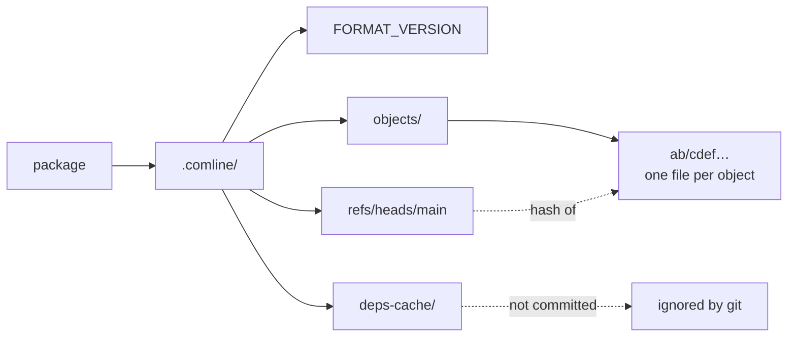
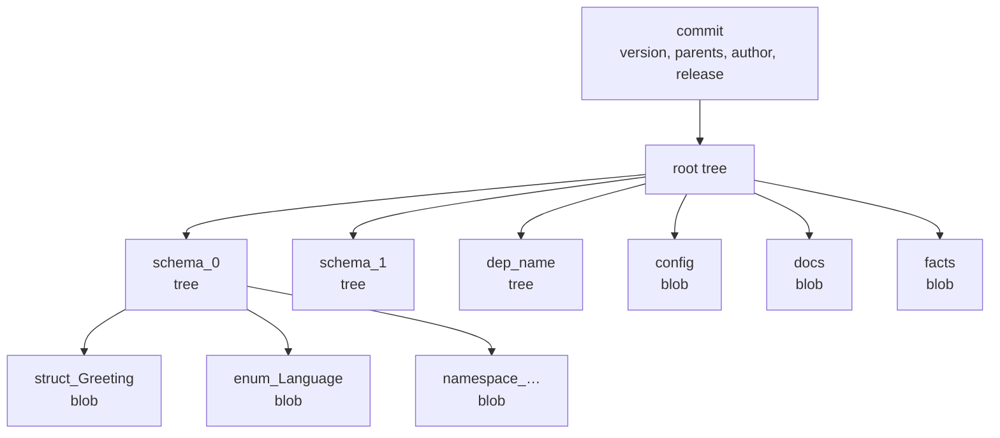
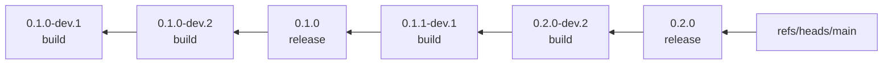
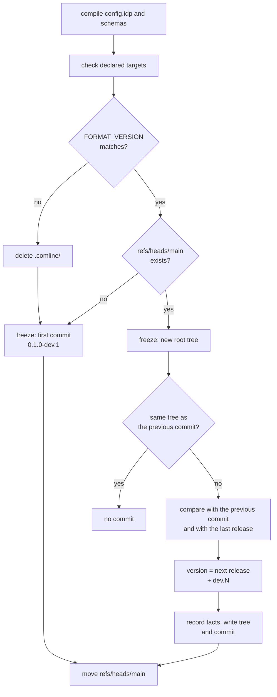

# Content-addressable storage (CAS)

Every `comline build` freezes the package into `.comline/`, its
content-addressable store. The store holds each version of the package as an
immutable commit, and the commits form one chain. This page covers what is on
disk, what the objects contain, how they are hashed, how builds and releases
make the chain, and what reads it.

It is modelled on [Git's object store](https://git-scm.com/book/en/v2/Git-Internals-Git-Objects),
with differences that suit a schema package. They are collected in
[Compared with Git](#compared-with-git).

## On disk

```
.comline/
├── FORMAT_VERSION          the IR format stamp, e.g. 3
├── objects/
│   └── ab/cdef…            one file per object, named by its hash
├── refs/
│   └── heads/main          the hash of the newest commit
└── deps-cache/             fetched git dependencies (not part of the store)
```



| Path | Contents |
|---|---|
| `objects/<xx>/<rest>` | One object. The 64 hex characters of its hash are split: the first two name the directory, the other 62 name the file. The file holds the object's bytes, LZ4-compressed. |
| `refs/heads/main` | The hash of the newest commit, as 64 hex characters. Updated at the end of every build and release. It is the only ref. |
| `FORMAT_VERSION` | The [IR format stamp](#the-ir-format-stamp) as a decimal number. |
| `deps-cache/` | Git dependencies fetched by `comline add` and by builds. A cache, not history. |

### What to commit

Commit `.comline/`, except `deps-cache/`. The store is the package's version
history, and nothing else holds it: there is no `publish` step yet. A clone
without `.comline/` starts over with no recorded versions, at `0.1.0-dev.1`.

`deps-cache/` is different. It is a checkout that can be fetched again from the
`uri` and `commit` pinned in `config.idp`. The `.gitignore` that `comline new`
writes ignores only that directory:

```
.comline/deps-cache/
```

`comline clean` never touches `.comline/`. `comline reset` deletes the whole
directory, history included, behind a typed confirmation or `--force`. See
[Packages & dependencies](../packages/index.md) for the package layout.

## Objects

There are three kinds of object file: blobs, trees and commits. A release is
not a fourth kind. It is a record inside a commit.

All objects are CBOR (see [Hashing](#hashing-and-compression)), so the field
names below are the keys in the stored bytes.

### Blob

A blob holds raw bytes.

| Field | Type | Meaning |
|---|---|---|
| `content` | bytes | The payload. For a schema unit, the CBOR of one frozen unit. |

Blobs hold three things: one frozen unit each (a struct, an enum, a protocol,
a constant, and so on), a version's `config`, `docs` and `facts`, and a
dependency's `manifest`.

### Tree

A tree lists named entries, like a directory.

| Field | Type | Meaning |
|---|---|---|
| `entries` | list of entry | In the order they were added. |

Each entry:

| Field | Type | Meaning |
|---|---|---|
| `mode` | `Blob` or `Tree` | What `hash` points at. |
| `name` | string | The entry's name in this tree. |
| `hash` | 32 bytes | The object's blake3 hash. |

A schema's tree has one blob entry per frozen unit, named by kind and
declaration: `namespace_<ns>`, `struct_<Name>`, `enum_<Name>`,
`protocol_<Name>`, `const_<Name>`. Other units are named by position:
`import_<n>`, `unit_<n>`.

### Commit

A commit is one version of the package.

| Field | Type | Meaning |
|---|---|---|
| `tree` | hash | The version's root tree. |
| `parents` | list of hash | The previous commit. Empty for the first commit. Today it holds at most one. |
| `author` | string | The user name of whoever built, from the operating system. |
| `timestamp` | integer | Unix time in seconds. |
| `message` | string | Written by Comline: `Initial commit`, `Build (Minor change)`, `Release 0.2.0`. |
| `version` | string | A release (`0.3.0`) or a build between releases (`0.3.0-dev.2`). |
| `release` | release record, optional | Present on commits made by `comline release`. Left out of the stored bytes otherwise. |

A commit is a release if it has a `release` record or its `version` has no
pre-release part. The second rule covers commits from before release records
existed.

### Release record

The `release` field of a release commit says how the version was reached. See
[Builds and releases](#builds-and-releases) for how the bumps are chosen.

| Field | Type | Meaning |
|---|---|---|
| `computed` | bump | The bump the changes since the previous release call for: `None`, `Patch`, `Minor` or `Major`. |
| `applied` | bump | The bump used. The computed one, or higher if `--raise` was given. |
| `reason` | string, optional | Why the bump was raised or the package made stable. |
| `covered` | bool | A raise was asked for, but the computed bump already reached it. The reason is kept as a note. |
| `stable` | bool | This release moved the package to `1.0.0`. |
| `since` | hash, optional | The previous release's commit. The changes behind this release are those between the two. Absent on the first release. |

## A version's root tree

A commit's `tree` is the root tree. Its entries are the whole package at that
version.



| Entry | Mode | Contents |
|---|---|---|
| `schema_<n>` | tree | One per schema file, numbered in build order, holding that schema's frozen units. |
| `dep_<name>` | tree | A dependency vendored into the commit: its own `schema_<n>` trees and a `manifest` blob with its verified content hash. Written by builds that include dependency support. |
| `config` | blob | The frozen `config.idp`, as a list of units. |
| `docs` | blob | The `//!` headers: the package's, and each module's by path. Only written when there is at least one. |
| `facts` | blob | The version's compatibility history, for `comline@2`. |

`dep_<name>` trees mean a version can be rebuilt from its commit alone, without
resolving the dependencies again.

### Why config, docs and facts sit beside the schemas

They are separate entries in the root tree, not part of any `schema_<n>` tree.
A schema's `schema_ir_hash` is computed over that schema's units alone.
Generated code embeds the hash, and so does the connection handshake. If the
`//!` headers, the config or the facts lived inside the schema, editing a
header or recording a new fact would move the hash and change the generated
code for no reason a consumer cares about.

Kept apart, they leave the schema trees and the hash as they were. The facts
go further: the build leaves them out when it decides whether anything changed,
because they follow from the rest. A rebuild that changes only `docs` or
`config` still makes a new commit. A rebuild that changes nothing makes none.

The `docs` and `facts` entries were added without a format bump. A reader of an
older version finds no entry and treats it as absent; a missing `facts` is
computed from the history when read.

## Hashing and compression

**Hash.** An object's address is the blake3 hash of its serialized bytes: 32
bytes, written as 64 hex characters. Identical content has an identical hash,
so an object that already exists is not written again. Unchanged schemas share
their trees and blobs across every version that contains them.

**Serialization.** Every object is encoded as CBOR. Structs are written with
their field names and enums with their variant names, not by position. Adding
a field to the frozen IR therefore does not break stores already on disk. The
same value always encodes to the same bytes.

A unit's blob is nested: the unit is CBOR-encoded into the blob's `content`,
and the blob is then CBOR-encoded and hashed. The hash is of the blob object,
not of the bare unit.

**Compression.** Objects are compressed with LZ4 (the `lz4_flex` block format
with the uncompressed size prepended). Hashing happens first, on the
uncompressed bytes. Reading an object decompresses it and checks that the hash
still matches; a mismatch is an error.

**Refs.** `refs/heads/main` is not an object. It is a plain text file with a
hash in it.

### The IR format stamp

`FORMAT_VERSION` records which shape of the IR wrote the store. This binary
expects `3`. It is not the package's `specification_version`; that is the
language edition the schemas are written in, and it is unrelated to how core
stores its own IR.

| Stamp | What changed |
|---|---|
| 1 | CBOR, replacing a position-based encoding. |
| 2 | A property's `expression` became a typed `value`. |
| 3 | Types became structured (`TypeRef`, `Literal`) instead of text. |

Because CBOR names its fields, only renaming or removing an existing field or
variant needs a new stamp. Additions do not.

!!! warning
    A store with a missing or different stamp cannot be read safely. The next
    `comline build` warns and deletes the whole `.comline/` directory, then
    starts again from `0.1.0-dev.1`. Upgrading to a Comline that bumped the
    stamp therefore costs the stored history. The same applies to a `.comline/`
    from before the stamp existed.

## Builds and releases

A **build** records history. A **release** is the version consumers see. The
full bump rules are in [Versioning rules](../../reference/versioning.md); this
section covers how they land in the store.



Arrows are parent links. Reading right to left walks back through history.

**`comline build`** freezes the working tree. The first build makes a commit
with no parent at `0.1.0-dev.1`. Each later build:

1. Builds a new root tree from the schemas, dependencies, config and docs.
2. Compares it, without `facts`, to the previous commit's root tree. If it is
   the same, it stops: no commit, no change to the ref.
3. Otherwise compares it with the previous commit for this build's own changes,
   and with the **last release** for the bump everything since calls for.
4. Names the build after the release it leads to: the last release bumped by
   that amount, plus a count of builds since it. A build that calls for no bump
   still leads to a patch release, so it never sorts before the release it
   follows.
5. Records the compatibility facts, writes the root tree and the commit, and
   moves `refs/heads/main`.



A package with no `.comline/` yet passes the stamp check, since there is
nothing to compare.

**`comline release`** builds first, so what is released is what is in `src/`
now. Then it adds one commit on top of the latest build:

- The commit has the build's tree, and the build as its parent. The tree is
  the same, unless the release is a different version from the one the build
  led to (a raised bump, or `1.0`). Then the compatibility facts name the new
  version, so the release gets a root tree of its own.
- Its `version` has no pre-release part, and it carries a [release
  record](#release-record).
- The bump is the highest the changes since the last release call for.
  `--raise <level> --reason <text>` goes higher and never lower, and the reason
  is required. The first release is `0.1.0`. `comline release 1.0` moves a
  `0.x` package to `1.0.0`.
- It refuses when there is nothing to release: the latest commit is already a
  release, or nothing since the last release calls for a bump (a raise releases
  anyway).

Before 1.0 the minor version plays the major's part: a breaking change goes
`0.3.2` to `0.4.0`, and anything else `0.3.2` to `0.3.3`. A `0.0.z` version
moves to `0.1.0` on any change.

See `comline release` in the [CLI reference](../../reference/cli.md).

## What reads the store

| Reader | What it reads |
|---|---|
| `comline build`, `comline release` | The ref and the previous commits, to compare and to number the next version. |
| `comline diff <old> <new>` | Two commits' root trees, compared with the same rules as a build: schema changes, changes within a dependency's reach, config changes and the bump they call for. |
| `comline inspect` | The newest build's `facts`, shown beside each protocol's wire summary. It writes nothing. See [`comline inspect`](../../reference/tools/inspect.md). |
| `comline doc --version <v>` | A built version's schema blobs, its `config` for the package name, and its `docs` headers. `--changelog-from <v>` adds the changes since an earlier version. See [`comline doc`](../../reference/tools/doc.md) and [Documenting your schemas](../documenting.md). |
| `comline generate` | With a pinned version or `"all"`, the frozen schemas of those versions. The default, `"latest"`, reads the working tree and not the store. |

`diff`, `doc --version` and `generate` find a commit by `HEAD`, a version
string such as `0.3.0-dev.2`, or a commit hash (the full 64 characters, or a
prefix of 4 or more that matches one commit). They walk the chain from
`refs/heads/main` through each commit's first parent.

### The `comline@2` facts

The `facts` blob stores a version's **history**: for each protocol (keyed by
`namespace::Protocol`), the release at which it last had a breaking change
(`line`), and for each function, the release it first appeared in (`since`).
These need history, so a build records them. Both name releases; a build
between releases carries the lines of the release it leads to.

The rest of what `comline@2` exchanges is computed from the version itself when
read, not stored: the package `id` from `config.idp`, each protocol's shape
hash, and each encoding's name and parameter hash (both blake3, as hex).

See [Compatibility facts](../../reference/versioning.md#compatibility-facts) for
what they mean and how they are compared. The `config.idp` keys are in the
[config.idp reference](../../reference/congregation/config-id.md), and where
generated code lands is set in
[`comline.toml`](../../reference/congregation/comline-toml.md).

## Branches

!!! note "Planned, not built yet"
    Everything in this section describes a design, not the current behaviour.
    It may change before it ships.

Today the chain is linear. There is one ref, each commit has at most one
parent, and nothing in the tools follows a second parent. If two Git branches
each build, they each move `refs/heads/main`. The object files merge without
conflict, since they are named by hash, but the ref is one file and Git reports
a conflict on it. Resolving it by hand picks one head and orphans the other
branch's commits.

The planned reconcile handles that after a Git merge leaves two heads:

- The next build rebuilds a single line of history from the two.
- Identifiers that were never released, the `-dev.N` counts, are renumbered
  to fit the one line. Released versions keep theirs.
- It refuses only if both branches made releases, since two releases cannot
  both keep their version.

The conditions for refusing, and what the user does then, are not decided.

## Compared with Git

| | Git | Comline |
|---|---|---|
| Hash | SHA-1 or SHA-256, over a `type size` header plus the content | blake3, over the object's serialized bytes |
| Loose object compression | zlib | LZ4 |
| Object encoding | Its own text and binary layouts | CBOR, with field names |
| Blob | A file's bytes | One frozen schema unit, or a `config`, `docs` or `facts` payload |
| Tree | Directories and files, sorted | `schema_<n>` per schema file, `dep_<name>` per dependency, plus `config`, `docs` and `facts` |
| Commit | Author, committer, message | Author name and timestamp, a generated message, a `version`, and for releases a `release` record |
| Refs | Many branches, tags, `HEAD` | One: `refs/heads/main` |
| History | Branches, merges, rewrites | One chain, never rewritten. Objects are never deleted. Merge handling is [planned](#branches). |
| Packing | Packfiles, garbage collection | None. Every object is its own file. |
| Version names | Hashes and tags you choose | `version` set by the diff, not typed in |

Because objects are never deleted or rewritten, any past version can be
rebuilt, diffed, documented or generated from at any time.
