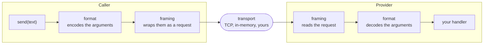
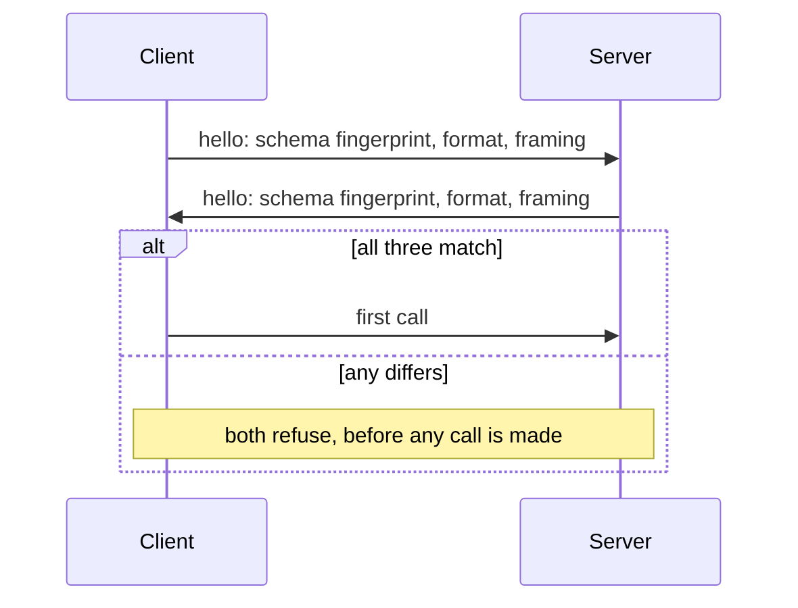
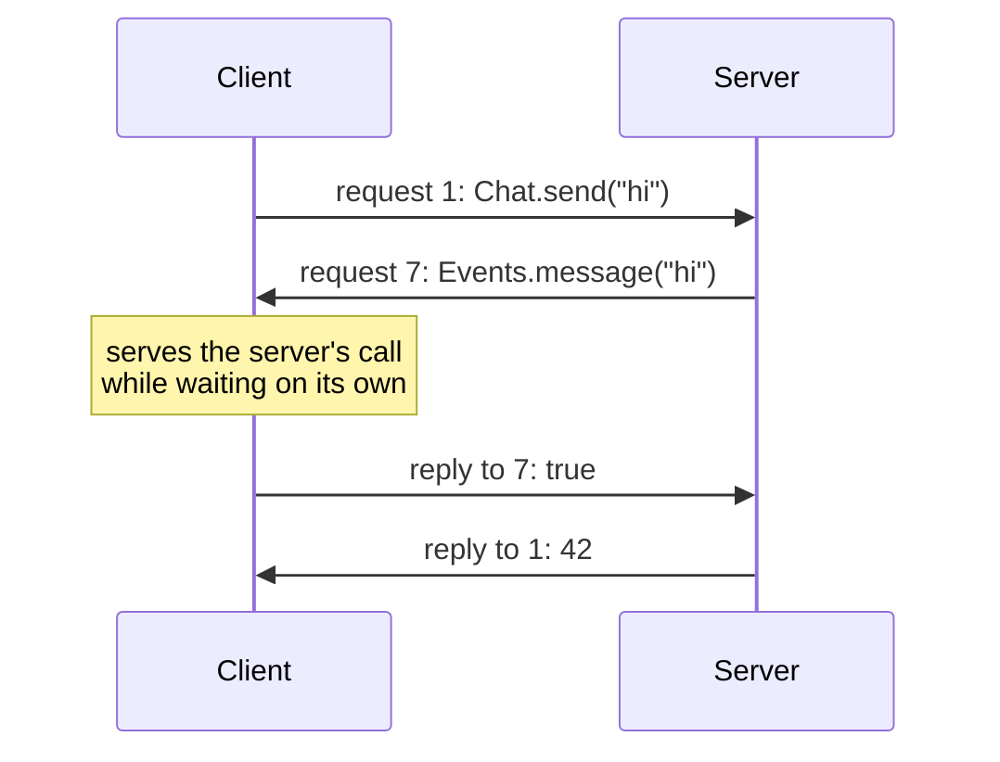

# Call systems & serialization

The **call system** (sometimes *CaSy*) is the part of the [runtime](index.md)
that turns a call to a [protocol](../idl/protocol.md) function into bytes on a
transport and back again. This page is the one place that explains its parts;
the rest of the docs link here.

## The layers

The reply goes back the same way. Each layer is chosen separately:

| Layer | What it does | Built in | Chosen by |
|---|---|---|---|
| **Format** | turns values into bytes | **`packed@1`** (the default: fixed-width fields, no tags or names, see [`packed@1`](../../reference/wire/packed.md)), `json@1`, `msgpack@1` (Rust only, for now) | the package's `wire.format` |
| **Framing** | wraps a call or a reply around those bytes | **`datagram@2`** (the default, for [connections](#connections)), its lockstep first version `datagram`, and [JSON-RPC 2.0](https://www.jsonrpc.org/specification) | a protocol's `@framing`, else the package's `wire.framing` |
| **Handshake** | checks both ends agree, before the first call | **`comline@1`** (the default), `none` | a protocol's `@handshake`, else the package's `handshake` |
| **Transport** | carries the frames | TCP and in-memory in Rust, in-memory in TypeScript | your code, when you connect |

The format, framing and handshake are part of the schema: both ends have to
agree on them, so they're declared once, in `config.idp`
([Wire defaults](../packages/index.md#wire-defaults)), and generated code uses
them without being told. What's built in, and what each one guarantees, is in
[Official encodings](../../reference/wire/official-encodings.md); you can
[add your own](../extending/encodings.md). The transport doesn't change the
bytes, so it's plain code you pass in.

JSON-RPC carries JSON, so a protocol on it uses `json@1` whatever the package
says. Which combinations each language supports is on its
[reference page](../../reference/languages/index.md#runtimes-side-by-side).

## Handshake

Before the first call, `connect` and `serve` run the protocol's handshake.
`comline@1` exchanges one small fixed-size frame each way:

A mismatch (different schema versions, one end MessagePack and the other JSON,
a different framing) is refused at once, rather than surfacing later as a
confusing decode error partway through a real call. Capability bits are
exchanged too, but a difference there is advisory.

A protocol talking to a peer that can't take part (a legacy service, say)
declares `@handshake = "none"` and says why with `@unverified`; see
[Giving up a guarantee](../idl/protocol.md#giving-up-a-guarantee). In the
runtimes the handshake is a trait (`Handshake`; an interface in TypeScript),
so a [custom one](../extending/handshakes.md) can be passed to
`Client::connect_with` / `Server::serve_with`. Hand-wired code can also skip it
at the call site with `Client::new_unverified` / `Server::serve_unverified`
(`Client.unverified` / `serveUnverified` in TypeScript), named so that skipping
is as visible there as in a schema.

## Connections

With the lockstep `datagram` framing, a client sends a request and reads the
next frame as its reply, one protocol per transport. A **connection**, which
every protocol uses by default, lifts that limit:

- **Either side can call,** since `datagram@2` marks each frame as a request
  or a reply.
- **Several calls can be in flight.** A reply is matched to its call by
  request id.
- **Several protocols share it.** Each frame carries its protocol's number.
- **A side waiting for a reply keeps serving the peer's requests,** so a
  handler can call back the peer that called it.

The runtime keeps the protocol logic in a core that does no I/O: bytes go in,
events come out ("serve this request", "this reply ends call 7"). The
`Connection` around it owns the transport. The handshake is the same as a
client's and a server's; a connection checks one hash over every schema in
the package, which also fixes the protocols' numbers.

Which protocols run on a connection is the schema's choice: see
[Calls in both directions](../idl/protocol.md#calls-in-both-directions).

## In code

[Language Guides](../../languages/index.md) has the concrete API in each
language: constructing a format, picking a framing, and what the handshake
looks like in code.
