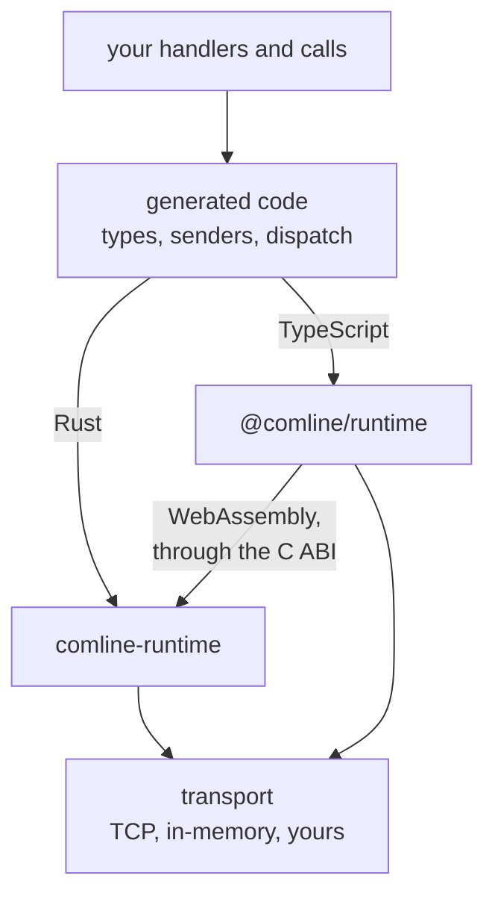

# Runtime

Transport, message parsing, and routing a [protocol](../idl/protocol.md) call to
its implementation all have to happen at run time. Comline provides a runtime
that does this, so each project does not reinvent it.

## Per-language runtimes

Each language has its own runtime, a normal dependency built and shipped like
any other library: `comline-runtime` for Rust, `@comline/runtime` for
TypeScript. Generated code calls into it; you rarely do.

The protocol logic that has to be byte-identical everywhere (framing, request
ids, the handshake's frames) is written once, in Rust: `comline-runtime` is
the [shared runtime core](../../proposals/shared-runtime-core/index.md), and
its [C ABI](../../reference/c-abi.md) exposes it to other languages. The
TypeScript runtime loads it as WebAssembly for its built-in framings, and falls
back to its own TypeScript implementation where the core can't load (a strict
content security policy, say) or for a framing of your own; both paths behave
the same and are tested the same. Codecs, generated types and transports stay
in each language.

Every runtime is checked against the same
[conformance vectors](../../reference/conformance.md), so a Rust peer and a
TypeScript peer generated from one schema speak the same bytes.

See [Language Guides](../../languages/index.md) for the practical,
per-language next step: spawning a client, serving a protocol, and the
concrete framing and wire-format API. This page stays the conceptual
overview.

## Call system

The pluggable part — the call framing (JSON-RPC, a compact binary format, a
custom one) and the message serialization — is the
[call system](call-system.md).

Generating the schema types the runtime needs is covered in
[Library generation](../codegen/library-generation.md).
