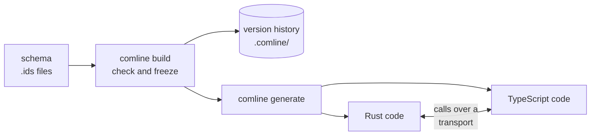

# Welcome to Comline

!!! warning "Early days"
    Comline is in heavy development and changes constantly. Much of this
    documentation is working design material rather than a polished reference:
    parts are dense and read closer to notes than prose.

Comline is a schema language and RPC toolkit. You describe your data and the
calls between programs once, in a schema, and Comline checks it, versions it,
and generates typed code for each language that talks over it. It sits in the
same family as [Protocol Buffers](https://protobuf.dev/),
[Cap'n Proto](https://capnproto.org/),
[FIDL](https://fuchsia.dev/fuchsia-src/get-started/sdk/learn/fidl),
[Apache Avro](https://avro.apache.org/) and
[Apache Thrift](https://thrift.apache.org/docs/idl).

## What makes up Comline

### [The schema language](./guide/idl/index.md)
Structs, enums, errors, constants and protocols, written in `.ids` files.
Beyond the shapes, a schema says how values are checked
([validators](./guide/idl/validator.md)), how calls travel
([framing and format](./guide/runtime/call-system.md)), and which rules a
package enforces on itself ([settings](./guide/idl/settings.md)).

### [Versions you don't write by hand](./reference/versioning.md)
`comline build` compiles the schemas into a frozen
[intermediate representation](./guide/ir/index.md) and stores it in
`.comline/`, an append-only history. The version number follows from what
changed since the last release, so a breaking change can't ship as a patch.

### [Generated code](./guide/codegen/index.md)
`comline generate` writes idiomatic code for each target language: types, a
trait or interface per protocol, clients, servers and connections. Rust and
TypeScript are supported today, each in two forms: source files to drop into a
project, or a buildable package.

### [A runtime per language](./guide/runtime/index.md)
Generated code links against a small runtime that runs the handshake, frames
calls and encodes values. The pieces are pluggable: the
[wire format](./reference/wire/official-encodings.md), the framing, the
handshake and the transport, including [your own](./guide/extending/index.md).

## Where to start

- [Getting started](getting-started.md): install the CLI and build a first
  package.
- [Guide overview](guide/index.md): the whole pipeline, stage by stage.
- [Language guides](languages/index.md): using the generated code in Rust or
  TypeScript.
