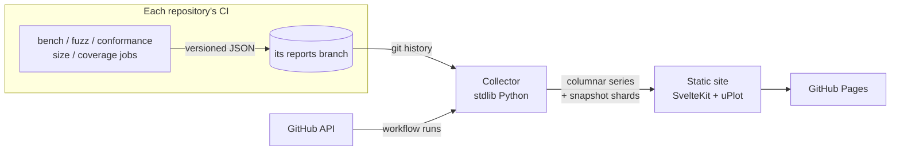

# Project dashboard

Status: **draft** · tracked in
[docs#151](https://github.com/ComlineProject/docs/issues/151) · Builds on the
[published results](shared-runtime-core/verification.md#published-results) of
the verification proposal

**The question:** where can the project's benchmark, fuzzing, conformance,
size, coverage and CI results be watched and analysed over time, and what is
built to get them there? It should be possible to view every published version
and compare any of them, so that has to be fast.

Decided so far (2026-11-08):

- a separate site in its own repository, not a section of this one;
- each repository publishes its reports to its own `reports` branch, whose git
  history is the data history;
- all six areas are in scope, delivered in stages;
- this proposal comes first, and the rest is decided in rounds.

## Where things stand

- **The runtime measures and publishes already.** Both reports below are
  committed by CI to the runtime's
  [`reports`](https://github.com/ComlineProject/runtime/tree/reports) branch,
  one commit per publish, so `git log -- rust.bench.json` is already a series.
  The scripts are in
  [`.github/scripts/`](https://github.com/ComlineProject/runtime/tree/main/.github/scripts).
  - **Benchmarks:**
    [`bench.yml`](https://github.com/ComlineProject/runtime/blob/main/.github/workflows/bench.yml)
    counts instructions with iai-callgrind for the runtime and the C ABI. A
    pull request is compared against its base and fails on a slowdown over 1%,
    unless
    [`accepted-regressions.toml`](https://github.com/ComlineProject/runtime/blob/main/runtime/core/benches/accepted-regressions.toml)
    accepts it. Every push to `main` publishes `rust.bench.json`
    ([schema](https://github.com/ComlineProject/runtime/blob/main/runtime/conformance/specs/gen/bench.schema.json)).
  - **Fuzzing:**
    [`fuzz.yml`](https://github.com/ComlineProject/runtime/blob/main/.github/workflows/fuzz.yml)
    runs 7 cargo-fuzz targets for a minute each per pull request. Nightly it
    runs them for ten minutes each, plus the property tests at 100,000 cases.
    The nightly run publishes `rust.fuzz.json`
    ([format](https://github.com/ComlineProject/runtime/blob/main/runtime/fuzz/README.md#the-report)).
- **This site shows only the latest snapshot.**
  `scripts/sync-language-support.py --render-reports` turns the two reports into
  tables on [Rust](../reference/languages/rust.md) and
  [TypeScript](../reference/languages/typescript.md) at build time. There is no
  history, no chart, no regression view and no way to open an older result.
- **The conformance matrices are committed JSON, rendered as static tables:**
  - generation's
    [`features.json`](https://github.com/ComlineProject/generation/blob/HEAD/features.json);
  - the runtime's
    [`reports/rust.json`](https://github.com/ComlineProject/runtime/blob/main/runtime/conformance/reports/rust.json);
  - TypeScript's `runtime/conformance-report.json`.

  Their history is the git history of `main`.
- **Everything else prints to a log or isn't measured:**

  | What | Where | Today |
  |---|---|---|
  | Parser benchmark | [`core/benches/parser_benchmark.rs`](https://github.com/ComlineProject/core/blob/HEAD/core/benches/parser_benchmark.rs) (criterion) | not run in CI |
  | TypeScript instruction counts | [`runtime/bench/`](https://github.com/ComlineProject/comline-typescript/tree/HEAD/runtime/bench) | printed, a manual tool for pull request evidence. The docs expect a `conformance-bench.json` that doesn't exist |
  | TypeScript differential properties | `nightly.yml` (fast-check, 20,000 runs) | pass/fail and an issue on failure, no report |
  | `comline conformance` | [`cli/src/commands/conformance.rs`](https://github.com/ComlineProject/cli/blob/HEAD/src/commands/conformance.rs) | text output only |
  | Binary and wasm sizes | the runtime's `ffi` job, `simulator/scripts/build-wasm.sh` | in logs |
  | Coverage, compile time, CI pass rates | | not measured |

## Proposal

Three layers, each joined by one contract:



### Producers: a report per kind, on each repository's `reports` branch

- Every repository that measures something publishes it the way the runtime
  already does: CI commits a JSON report to an orphan `reports` branch that
  only CI writes to. `main` stays pull-request only.
- **Kinds:** `bench`, `fuzz`, `conformance`, `size` and `coverage`. CI health
  needs no producer, since the collector reads it from the GitHub API.
- **One envelope for every kind:** `kind`, `schema_version`, `repo`, `commit`,
  `date`, `run` (the workflow run URL) and `toolchain`, then the kind's body.
  The runtime's bench and fuzz formats become version 1 of their kinds.
- **Schemas:** CUE, with JSON Schema generated from it, following the
  runtime's
  [`conformance/specs/`](https://github.com/ComlineProject/runtime/tree/main/runtime/conformance/specs).
- **Publishing:** the runtime's `publish-report.py` becomes a reusable
  composite action in the dashboard repository, so a repository adds one
  step instead of a copy of the script:

  ```yaml
  - uses: ComlineProject/<dashboard>/.github/actions/publish-report@v1
    with:
      file: rust.size.json
  ```

### Collector: rebuild every series from git

- **Language:** Python standard library only, like this repository's
  `scripts/`.
- **Inputs:** a sources file lists each `(repository, branch, path, kind)`.
  For each one, the collector:
  - clones the branch blobless;
  - walks `git log --format=%H%x00%cI -- <path>`;
  - reads every version with `git show <rev>:<path>`.

  The committed conformance matrices are read the same way from `main`.
- **Releases:** a report's commit is mapped to the release tag containing it,
  so releases appear as named versions.
- **CI health:** the job's own `GITHUB_TOKEN` reads workflow runs and their
  conclusions from the REST API. Every repository is public, so no other token
  is needed.
- **Resilience:** a source that can't be reached is shown as "not published
  yet", as the docs script already does, so one broken source never fails the
  build.
- **Output:** the data layout under
  [Versions and comparison](#versions-and-comparison).

### Site

**Recommended: SvelteKit with `adapter-static`, Vite and TypeScript**, the
stack the tutorial already uses (Svelte 5, Kit 2, Vite 7).

| Piece | Choice | Why |
|---|---|---|
| Charts | **uPlot** (MIT, about 50 KB) | It draws on canvas, so hundreds of series over thousands of versions stay smooth. SVG charting slows down at that size |
| Tables | Svelte tables, sortable, with virtualized rows | A table of every benchmark between two versions keeps only its visible rows in the DOM |
| Assets | self-contained, no CDN | the same rule as the [HTML doc renderer](auto-documentation.md) |
| Theme | light and dark, following the OS | the same as this site and the HTML doc renderer |

### Versions and comparison

Every published version can be opened and compared, so the data is laid out
for random access and comparisons are computed in the browser.

**What a version is:** one published report, meaning one commit on a `reports`
branch, or one change to a committed matrix on `main`. A version that falls
in a release shows that release's name. The picker groups dev builds under
their release, the way the HTML doc renderer's picker does.

**Views:**

| View | Shows |
|---|---|
| **One version** | the full snapshot at that version |
| **A against B** | any two versions. Benchmarks: absolute and percentage change, sorted by the largest regression, filterable by group and threshold. Fuzzing: per-target changes. Conformance: the cells whose state changed, and the case ids added or removed |
| **N versions** | a grid or an overlay of chosen versions, for example every release |

The selection lives in the URL (`?a=<rev>&b=<rev>` or `?v=<rev>,<rev>,…`), so
a comparison can be shared as a link.

**Data layout,** per kind and repository:

| File | Holds | Loaded |
|---|---|---|
| `versions.json` | the index: commit, date, release and run of each version, in order | with the page |
| Columnar series | one array per metric, aligned to the index, with `null` where a version has no value. Large series are typed-array binaries (`.f64`, `.u32`) with a JSON manifest, loaded straight into a `Float64Array` | with the page |
| Snapshot shards | per-version detail that comparing doesn't need: per-target fuzz statistics, property verdicts, conformance case ids | when that version is opened |

- **Comparing A with B** reads one array entry per metric, so its cost grows
  with the number of metrics and not with history. Pairwise differences are
  never precomputed, because there are N² of them.
- **Caching:** files are named by a hash of their content, so a browser caches
  them indefinitely and a rebuild changes only the files whose data changed.
- **Rendering:**
  - the page shell is prerendered, so the first paint doesn't wait for data;
  - each page fetches only its own data;
  - overview charts are downsampled with LTTB, and full resolution loads on
    zoom;
  - a comparison over the largest set moves into a Web Worker if it measures
    over one frame.

**Budgets,** checked in CI against a synthetic dataset ten times today's size:

| Budget | Limit |
|---|---|
| First contentful paint | under 1 s |
| Switching A or B | under 50 ms |
| A page's initial data | under 500 KB compressed |

A Playwright timing test fails the build when a limit is exceeded.

### Pages

| Page | Shows |
|---|---|
| **Overview** | latest state per repository and kind, with sparklines and a pass/fail badge |
| **Benchmarks** | a series per benchmark, each point linking to its commit; steps over 1% highlighted and cross-checked against `accepted-regressions.toml`; filters by group (`comline2/`, `ffi/abi/`, …); payload-size views for the 16 B to 64 KB families; once TypeScript publishes, the [ratio to Rust](shared-runtime-core/verification.md#budgets) |
| **Fuzzing** | per target: executions, corpus size and findings per night; a strip of property-test verdicts; nights that didn't run shown as gaps, not zeros |
| **Conformance** | the generator feature × language and wire feature × runtime matrices; each cell drills down to the cases that prove it; a timeline of state changes such as *partial* → *supported* |
| **Size** | `.so`, `.a` and `.wasm` of the C ABI and the simulator, and the CLI binary, over time |
| **Coverage** | line and branch coverage per crate and package, over time |
| **CI health** | pass rate, duration and reruns per workflow and repository |

This site keeps its "latest" tables on the language pages and links each to
its dashboard page.

### Build and deploy

The dashboard repository's workflow:

- **Runs:**
  - daily at 04:30 UTC, after the runtime's fuzz nightly (03:17) and before
    this site's daily rebuild (06:00);
  - every few hours, to catch benchmark publishes;
  - on demand (`workflow_dispatch`).
- **Steps:** collect, build, run the budget test, then deploy with
  `upload-pages-artifact` and `deploy-pages`, as this site and the playground
  do.
- **Not yet:** `repository_dispatch` from producers, which would rebuild on
  every publish but needs a cross-repository token.

### Dependencies

| Layer | Needs |
|---|---|
| Site | `svelte`, `@sveltejs/kit`, `@sveltejs/adapter-static`, `vite`, `typescript`, `uplot`; a virtual list, small or hand-written. Development only: `playwright` for the budget test |
| Collector | Python 3 (standard library), `git`, the GitHub REST API |
| Producers | already in use: `iai-callgrind`, `cargo-fuzz`, `proptest`, `fast-check`. New: `cargo-llvm-cov`, and `@vitest/coverage-v8` or `c8` |
| CI | `actions/checkout`, `setup-node`, `setup-python`, `upload-pages-artifact`, `deploy-pages` |

## Rollout

| Stage | Producers | Dashboard |
|---|---|---|
| **1** | none new | the collector, the site, and the version and comparison views over the runtime's bench and fuzz history and the conformance matrices' history on `main`. This proves the whole pipeline end to end |
| **2** | TypeScript publishes `typescript.bench.json` from `runtime/bench/count.mjs`, which also fills the report the docs already expect, and `typescript.fuzz.json` from its nightly; `comline conformance --json` | the Rust↔TypeScript ratio view; per-run results from the conformance CLI |
| **3** | a size job in runtime, simulator and cli; coverage from `cargo-llvm-cov` (Rust) and v8 coverage (TypeScript); the parser benchmark in core's CI | the Size and Coverage pages |
| **4** | none, since CI health comes from the API; compile time from `cargo build --timings` | the CI health page and compile-time series |

## What it touches

| Repository | Change |
|---|---|
| a new repository | the collector, the site, the publish action, the schemas (if they move there), the deploy workflow |
| runtime | switch to the shared publish action; add a size job (stage 3) |
| comline-typescript | bench and nightly reports (stage 2), coverage (stage 3) |
| cli | `comline conformance --json` (stage 2) |
| core | the parser benchmark in CI (stage 3) |
| simulator, other Rust repositories | size and coverage jobs (stage 3) |
| docs (this repository) | links from the language pages to the dashboard |

## Alternatives considered

- **A section of this site.** Rejected (2026-11-08). It would tie the docs
  build to every data source, and zensical is built for Markdown pages, not
  for interactive data views.
- **Hosted services** (Bencher, Codecov). Rejected (2026-11-08). The data
  would be spread across vendors and live on third-party services, and none of
  them shows conformance matrices.
- **A central data repository** that every CI pushes to. Rejected (2026-11-08)
  for per-repository `reports` branches. It would give one place to query, but
  every repository would need write access to it.
- **Workflow artifacts or release assets as the store.** Artifacts expire
  after at most 90 days, which loses the long history.
- **Observable Plot instead of uPlot.** It has nicer declarative charts, but
  it renders SVG, which is too slow for views over every version. It could
  still draw small static charts.
- **Observable Framework** has data loaders built in and fits the shape well;
  its maintenance status should be checked before it is chosen.
- **Static HTML generated by Python** with a vendored chart library needs the
  least tooling, but it gives the weakest interaction, and comparing versions
  is the main use.

## Open questions

- **Name and address:** for example `observatory`, `status` or `dashboard`,
  at `comlineproject.github.io/<name>/`.
- **Where the schemas live:** in the dashboard repository, or kept with the
  runtime's conformance specs.
- **What "a version" means:** every published report, as above, or only
  releases, or also the published std and package versions.
- **Retention:** all history, or a cap with older versions thinned out.
- **The parser benchmark:** move it to instruction counts so it can gate, or
  keep criterion's wall time as a noisy trend that never gates.
- **Gating:** the proposal keeps every gate in each repository's own CI, and
  the dashboard only shows results. Is that right?
- **A dedicated runner for wall time,** already raised in
  [Judging a regression](shared-runtime-core/verification.md#judging-a-regression-without-flaky-ci):
  is it in scope here?
