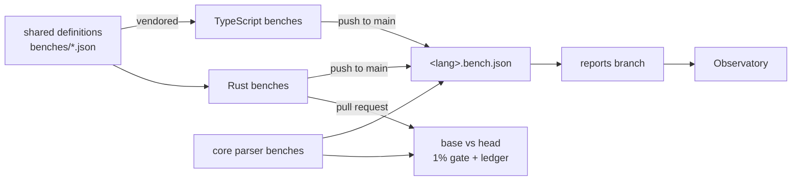

# Benchmarks

How performance is measured, gated and published. The source of truth for
the shared definitions is the runtime's
[`runtime/conformance/benches/README.md`](https://github.com/ComlineProject/runtime/blob/main/runtime/conformance/benches/README.md).

The gates count **instructions** (iai-callgrind or Callgrind, under
Valgrind), not time. Instruction counts are deterministic, so a 1% limit
holds on shared CI machines without flaking. A count compares only against
the same runtime on another commit, never across languages or machines.

## Flow



## Shared definitions

`runtime/conformance/benches/*.json` defines the work every runtime measures,
so ids line up across languages. Each file says what is inside the measured
region; anything it doesn't name (building inputs, allocating the output
buffer, I/O) is outside.

| File | Measures | Ids |
| --- | --- | --- |
| `formats.json` | encode and decode per format, per shape (`small-scalar`, `string-heavy`, `nested`, `large-array`, `enum-heavy`) | `format/<encode\|decode>/<shape>/<format>` |
| `framings.json` | framing encode and decode per framing, per payload size | `framing/<encode\|decode>/<framing>/<size>` |
| `handshake.json` | the handshake frame: encode, decode, check | `handshake/<encode\|decode\|check>` |
| `comline2.json` | the `comline@2` hello: encode, decode, answer | `comline2/<encode\|decode\|answer>` |
| `connection.json` | one connection step: issue a call, receive its reply | `connection/step` |

The files use the [conformance vectors'](wire.md) value encoding, plus a
`generate` rule for large values. `specs/bench.cue` specifies them, and
`tests/bench_definitions.rs` checks them against the Rust mirrors. The Rust
benches are the reference: where the README and they disagree, one of them
has a bug.

## Per repository

| Repository | What | Metric | Pull request | Push to default branch |
| --- | --- | --- | --- | --- |
| runtime | the shared definitions (`runtime/core/benches`) and the C ABI (`runtime/ffi/bench`) | instructions | base and head in one job, **gated** | head benched, `rust.bench.json` published |
| core | the parser (`core/benches`, over `core/benches/inputs/`) | instructions (gated); wall time with Criterion (reported only) | base and head, **gated** | `core.bench.json` published |
| comline-typescript | the shared definitions, vendored | instructions in two tiers: `--no-opt` and optimizing after warm-up | each benchmark runs once, uncounted | counted, `typescript.bench.json` published |

- The runtime's C ABI benches add `ffi/abi/<call>` and `ffi/core/<call>`
  pairs. The job summary shows the crossing cost between them, for
  information only.
- comline-typescript isn't gated yet. Its optimizing tier is what the
  Observatory's ratio to Rust uses.
- Wall time is never gated: on shared runners it's noise.

## The gate

On a pull request, runtime and core bench the base and then the head in the
same job, on the same machine:

- A benchmark that grows **more than 1%** fails.
- A benchmark the base had and the head doesn't run fails.
- A new benchmark has nothing to compare against, and is recorded only.

A cost that is the price of a fix is accepted in the diff, by appending to
the repository's `accepted-regressions.toml`:

```toml
[[accepted]]
pr = 123                      # the pull request that pays it
bench = "handshake/check"     # one benchmark id, exactly
max_percent = 2.37            # the most it may grow, in %
reason = "check the peer's ids in constant time (#120)"
```

- An entry counts only in the pull request that adds it (`pr` must be its
  number), covers one benchmark up to `max_percent`, and must be used.
- `[[removed]]` (with an optional `renamed_to`) covers a dropped or renamed
  benchmark. A renamed one is compared under its new id.
- The ledger is append-only. Nothing is accepted by a label, a setting or a
  default.
- The job summary prints the entry to paste, with the measured growth rounded
  up.

The Observatory reads the ledger too: a step of more than 1% between two
published versions is marked **accepted** when a ledger entry explains it, and
**unexplained** otherwise.

## Outputs

Reports go to each repository's `reports` branch, one commit per publish:
`rust.bench.json`, `core.bench.json`, `typescript.bench.json`. A pull request
writes its report as an artifact only.

```json
{
  "runtime": "rust",
  "commit": "<the measured commit>",
  "toolchain": "rustc 1.100.0-nightly (787af2b8c 2026-08-25)",
  "metric": "instructions",
  "benches": { "format/encode/small-scalar/packed@1": { "ir": 123 } }
}
```

That is format 1. Format 2, used by core and comline-typescript, allows several
metrics per benchmark: `{"<metric>": {"value", "runner"?, "spread"?}}`. A
metric with a `runner` is charted per runner. See the Observatory's
[`DATA.md`](https://github.com/ComlineProject/observatory/blob/main/DATA.md#bench).

The core parser also has local-only Criterion runs (`core/benches/run_bench.sh`)
that write HTML reports.
