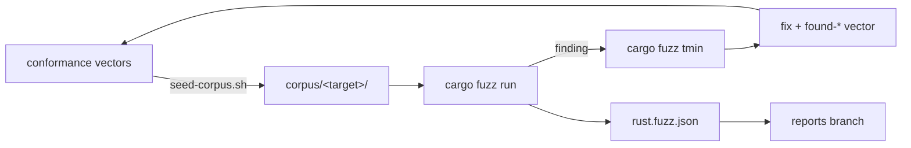

# Fuzzing

How the reference runtime is fuzzed, and how other runtimes are tested
against it on random inputs. The source of truth is the runtime's
[`runtime/fuzz/README.md`](https://github.com/ComlineProject/runtime/blob/main/runtime/fuzz/README.md).

The Rust runtime is the reference every other runtime is checked against, so
its decoders must be strict, canonical and panic-free. Two kinds of test
check that:

- **Coverage-guided fuzzing** (`cargo-fuzz`, libFuzzer, nightly Rust) on raw
  bytes.
- **Property tests** (`proptest`) on structured inputs: round trips over
  random types and values, and the C ABI against the core.

## Flow

1. **Seed.** `seed-corpus.sh` writes every conformance vector's bytes, every
   test mirror's samples and whole connection exchanges into
   `corpus/<target>/`, encoded as each target reads its input. The fuzzer
   starts from real frames, not from nothing.
2. **Fuzz.** Each target reads its input through a fixed grammar, one byte
   per choice, so a seed can be written back in it. Memory is capped
   (`-rss_limit_mb=2048 -malloc_limit_mb=512`), and going past a cap counts as
   a crash.
3. **Report.** `.github/scripts/fuzz-report.py` turns libFuzzer's stats and
   the property tests' verdicts into `rust.fuzz.json`.
4. **A finding becomes a vector.** Minimize it, fix the runtime (never weaken
   the assertion), add the input as a `found-*` case and bless the vectors.
   From then on every runtime checks it on every run.

## Targets

| Target | Checks |
| --- | --- |
| `decode_no_panic` | decoding never panics, stays within the memory caps, and anything it accepts passes `check` |
| `packed_canonical` | bytes that decode in `packed@1` re-encode to exactly themselves |
| `framing_decode` | every framing, envelope and handshake decoder: no panic; binary frames re-encode exactly; JSON-RPC decodes the same after a round trip |
| `seed_vs_derive` | the conformance crate's `TypeSeed` accepts, refuses and reads exactly what a `serde` derive does |
| `stream_split` | stream framing splits and prefixes exactly by the declared length and limit |
| `ffi_feed` | the C ABI keeps its own rules: no panic crosses, statuses and spans are valid, no allocation after `comline_connection_new` |
| `ffi_vs_core` | the C ABI gives the same results as the core called directly |
| `ffi_comline2` | a `comline@2` connection through the C ABI, under any side and parameters, fed any frames |

Property tests: `conformance/tests/properties.rs` (round trips over random
types and values) and `ffi/tests/differential.rs` (the C ABI against the
core on random sequences).

## When it runs

| Run | Fuzzing | Property tests | On failure |
| --- | --- | --- | --- |
| Every pull request | 60 s per target, seeded corpus | default case count, with `cargo test` | the check fails |
| Nightly (03:17 UTC) and manual | 600 s per target, corpus cached between runs | `PROPTEST_CASES=100000` | the minimized crash is uploaded, and an issue titled after the target is opened (unless one is open). Nobody's pull request is blocked |

## Other runtimes

A runtime that isn't the reference compares itself with it through
`comline-reference`, which answers any [ops protocol](wire.md#the-ops-protocol)
question.

comline-typescript's nightly workflow (03:17 UTC) installs `comline-reference`
at the corpus's `VECTORS_REV` and runs its property tests
(`runtime/test/prop/`) against it at many more runs than a pull request's.
Connection logic is compared through the `session` op. A failure opens or
comments on an issue. Coverage-guided fuzzing (Jazzer.js) isn't set up yet.

## Outputs

| Report | Written by | Published |
| --- | --- | --- |
| `rust.fuzz.json` | runtime `fuzz.yml`, every run | nightly or manual from `main` |
| `typescript.fuzz.json` | comline-typescript `nightly.yml`, pass or fail | every nightly run |

Both go to their repository's `reports` branch. The
[Observatory](reports.md) charts executions, corpus size, findings and
property verdicts per target, and the
[Rust language page](../languages/rust.md) renders the latest Rust run. The report
format is in the
[fuzz README](https://github.com/ComlineProject/runtime/blob/main/runtime/fuzz/README.md#the-report).

Pull requests write the report as an artifact only.
