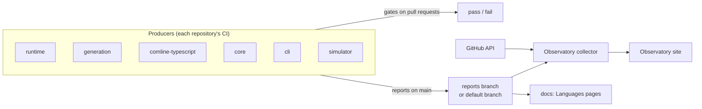

# Conformance

How Comline proves its implementations agree, and how it keeps track of
their speed, size and health over time. Each subject has its own page. This
one shows how they fit together.

## The pipeline

1. **Pull requests are gated** in each repository's own CI: vectors and
   goldens must match, support claims must be proven, fuzz targets must
   survive a short run, and instruction counts must not grow more than 1%
   without a ledger entry.
2. **Pushes to the default branch publish reports**, one JSON file per
   measurement, committed to the repository's `reports` branch. Conformance
   reports are committed on the default branch itself.
3. **The Observatory collects** every report's history, so each published
   version can be opened and any two compared. It shows results and gates
   nothing.
4. **The docs render** the latest conformance, fuzz and bench results into the
   [Languages](../languages/index.md) pages at build time.

## Subjects

| Page | Proves or measures | Gate on pull requests | Published as |
| --- | --- | --- | --- |
| [Wire conformance](wire.md) | every runtime reproduces the wire contract byte for byte | yes: vectors current, claims proven | `reports/<lang>.json` |
| [Generator conformance](generators.md) | each generator's output, and the features it claims | yes: goldens match, claims proven | `features.json` |
| [Fuzzing](fuzzing.md) | the reference's decoders are strict, canonical and panic-free; other runtimes match it on random inputs | yes: 60 s per target | `<lang>.fuzz.json` (nightly) |
| [Benchmarks](benchmarks.md) | instruction counts of shared and per-repository benchmarks | yes: 1% limit plus the ledger | `<name>.bench.json` |
| [Timings, size and coverage](timings.md) | compile time, CI time, artifact sizes, test coverage | no | `<name>.compile.json`, `.size.json`, `.coverage.json`; CI from the API |
| [Reports and the Observatory](reports.md) | how reports are published, collected and compared | — | — |

## Schedule

| When (UTC) | What |
| --- | --- |
| every pull request | conformance, short fuzz, bench gate |
| every push to a default branch | benches, size, coverage and compile reports published |
| 03:17 nightly | long fuzz and property runs (runtime), differential tests against the reference (comline-typescript) |
| 04:30 daily, and every 4 hours | Observatory rebuilt |
| 06:00 daily | docs rebuilt, picking up the nightly fuzz reports |
| Mondays 07:45 | docs drift check of the Languages pages against conformance |
