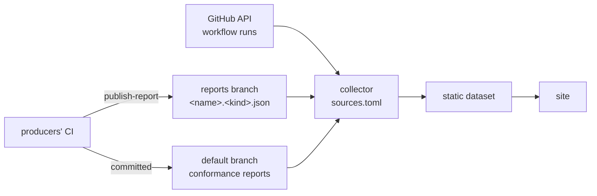

# Reports and the Observatory

How every result on the other pages reaches the
[Observatory](https://comlineproject.github.io/observatory/), where each
published version can be opened and any two compared. The source of truth is
the Observatory's
[`README.md`](https://github.com/ComlineProject/observatory/blob/main/README.md)
and [`DATA.md`](https://github.com/ComlineProject/observatory/blob/main/DATA.md),
the contract between its collector and its site.

The Observatory only shows results. Every gate stays in the producing
repository's own CI.

## Flow



1. **Producers publish.** A repository's CI writes a JSON report, and the
   shared `publish-report` action commits it to the repository's `reports`
   branch.
2. **Each commit is one version.** The collector walks every source's branch
   first-parent, and each commit that changed the report becomes a version.
   `git log -- <report>` on the `reports` branch is the series.
3. **Versions are labelled by release.** A version is `<cycle>-dev.<n>`,
   where the cycle is the oldest release tag containing the measured commit,
   or `unreleased`. Labels are recomputed on every run, so a new tag regroups
   older versions.
4. **The site renders the dataset.** It's a static SvelteKit site, rebuilt
   daily at 04:30 UTC, every 4 hours, on every push to the observatory and on
   demand.

## Publishing

`ComlineProject/observatory/.github/actions/publish-report@v1`:

- is called only from the default branch, a schedule or a manual run, never
  from a pull request. Anywhere else, callers pass `dry-run: true`;
- needs `permissions: contents: write` and a checkout with `fetch-depth: 0`;
- requires each report to carry the `commit` it measured, and skips a report
  older than the one already published, so a slow run never overwrites a
  newer one;
- can publish a `readme` as the branch's `README.md`, which says what the
  branch holds (`.github/reports-branch.md` in each repository).

The conformance matrices are the exception: they're committed on the default
branch by the tests that prove them, and read from there.

## Sources

[`sources.toml`](https://github.com/ComlineProject/observatory/blob/main/sources.toml)
lists everything the collector reads. A source that fails (unreachable, no
versions, a report that doesn't parse) is shown as unpublished with a reason,
and the rest still build.

| Kind | Page | Sources |
| --- | --- | --- |
| `conformance` | [Wire](wire.md), [Generators](generators.md) | `wire` matrix: Rust and TypeScript runtime reports; `codegen` matrix: generation's `features.json` |
| `fuzz` | [Fuzzing](fuzzing.md) | runtime, comline-typescript |
| `bench` | [Benchmarks](benchmarks.md) | runtime, core, comline-typescript |
| `compile` | [Timings](timings.md#compile-time) | runtime, core, cli |
| `ci` | [Timings](timings.md#ci-time) | every repository, from the GitHub API |
| `size` | [Timings](timings.md#size) | runtime, cli, simulator, comline-typescript |
| `coverage` | [Timings](timings.md#coverage) | runtime, core, cli, generation, comline-typescript |

A conformance matrix combines its sources into one table. Their histories are
separate, so a matrix version is a point in time: each source at its newest
version on or before that date.

## Reading the site

- Every kind has an index page and a page per source. There is also `ratio`,
  which shows TypeScript instruction counts relative to Rust's.
- **Compare:** pick two versions, and the URL keeps them (`?a=<label>&b=<label>`;
  for a matrix, `?a=<source>:<label>`). A table shows the change per metric,
  coloured by whether higher or lower is better for it.
- **Steps:** on instruction counts, a move of more than 1% between two
  consecutive versions is marked accepted when a regression-ledger entry
  explains it, and unexplained otherwise. See
  [Benchmarks](benchmarks.md#the-gate).

## Running locally

```sh
python3 collector/collect.py --sources sources.toml --out site/static/data \
    --local runtime=../runtime --local generation=../generation
cd site && npm ci && npm run dev
```

`--local name=path` reads an existing checkout's `origin/<branch>` refs
without writing to it. `--no-network` skips the GitHub API, which leaves the
`ci` sources unpublished.
