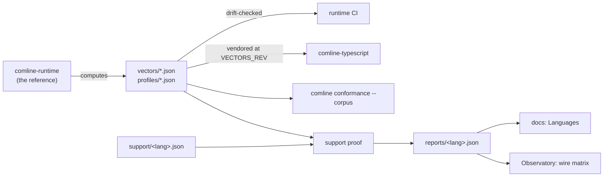

# Wire conformance

How the wire contract is proven: byte-exact vectors that every runtime must
reproduce, the case format and the ops protocol an implementation speaks to be
tested. The guide to using it for your own encoding is
[Formats and framings](../../developer/extending/encodings.md).

The source of truth is the runtime's
[`runtime/conformance/README.md`](https://github.com/ComlineProject/runtime/blob/main/runtime/conformance/README.md)
and the
[`comline-reference` README](https://github.com/ComlineProject/runtime/blob/main/runtime/reference/README.md#the-protocol).
This page summarizes them and links there for the long tables. Where they
differ, they win.

## Flow



1. **The Rust runtime is the reference.** `runtime/conformance/src/lib.rs`
   computes every case from `comline-runtime`. `vectors_are_current` fails
   when `vectors/` differs, so a changed vector shows up in review as a
   wire-protocol change. `CONFORMANCE_BLESS=1 cargo test -p comline-runtime-conformance`
   rewrites them.
2. **The file formats are specified in CUE** (`specs/*.cue`). The JSON
   Schemas in `specs/gen/` are generated from them, and every corpus file
   names its schema in `$schema`. `specs/check.sh --check` regenerates the
   schemas and vets every file in CI. What CUE can't express, `cargo test`
   checks.
3. **Each runtime claims support** per feature (`supported`, `partial` with
   the failing cases named, or `unsupported`) and proves the claim against the
   vectors. The proof writes a report naming the cases behind each claim,
   which is drift-checked too. See [Support claims](#support-claims).
4. **Other runtimes vendor the corpus** at a pinned commit.
   comline-typescript keeps it in `runtime/test/conformance/` at
   `VECTORS_REV`. `scripts/vendor-conformance.sh <rev>` takes a newer one,
   and CI checks that the copy is unedited.
5. **Implementations are driven over the [ops protocol](#the-ops-protocol)**
   by `comline conformance`: third-party encodings with their own vectors, and
   the official ones with `--corpus`. comline-typescript's CI runs its
   conformance server this way.
6. **Beyond the vectors,** the `comline-reference` binary answers any
   question in the same encoding. comline-typescript's nightly property tests
   compare its runtime with the reference on random inputs, and
   [fuzzing](fuzzing.md) does the same for the reference itself. What they
   find becomes a `found-*` vector.

## Version

**Spec version: `0.10`** (`runner::SPEC_VERSION`). It covers the case format
(`vectors/*.json`, `profiles/*.json`), the ops, and the value and type
encodings.

- While Comline is in its early days (0.x), a minor version of the spec may
  change anything, and the change is named in the pull request that makes it.
- The **ops protocol** keeps its own number, `protocol: 1` in a `version` reply.
  Under it, ops and reply fields are only ever added.

Changes, newest first (in full in the
[runtime README](https://github.com/ComlineProject/runtime/blob/main/runtime/conformance/README.md#the-spec-version-010)):

- **0.10:** a framing states `directions` (`both` or `one`). New cases
  refuse a request read as a response and the other way round. `jsonrpc@1`
  refuses a response with neither `result` nor `error`.
- **0.9:** new op `peer_refusal`, which reads JSON-RPC's error with a `null`
  `id`.
- **0.8:** `jsonrpc@1` leaves `params` out of a request without any.
- **0.7:** a framing states `payload` (`opaque` or `json`) and a format states
  `output` (`bytes` or `json`). New `"expect": "accept"`.
- **0.6:** `calls` and `errors` facts must be shown by their cases, not just
  named.
- **0.5:** the corpus format is specified in `specs/`, and malformed inputs
  and profiles are refused at load.
- **0.4:** `datagram@3` and `comline@2`, with the ops `comline2_message` and
  `comline2_negotiate`.
- **0.3:** bounds and `char`
  ([core#98](https://github.com/ComlineProject/core/issues/98)).
- **0.2:** handshake facts `schema_agreement` and `encoding_agreement`, and the
  op `handshake_check`.
- **0.1:** the first published version.

## Files

| File | Holds |
| --- | --- |
| `features.json` | the official wire features and their ids (runtime corpus only) |
| `vectors/<feature>.json` | `{"feature": "<feature>", "cases": [...]}`: one feature's cases |
| `profiles/<name>.json` | one encoding's [profile](../../developer/extending/encodings.md#2-write-the-profile) |
| `support/<lang>.json` | a runtime's claims, per feature |
| `reports/<lang>.json` | the claims with the cases that prove each |
| `benches/*.json` | the shared [benchmark definitions](benchmarks.md#shared-definitions) |
| `specs/` | the CUE specs, and the JSON Schemas generated from them |

**A package's vectors** sit beside its profile: the profile's path with `.json`
replaced by `.vectors.json`. `profiles/lines.json` has
`profiles/lines.vectors.json`. Every case in the file is run, and the profile's
`proven_by` names cases in it. The official encodings keep a `vectors/`
directory in the runtime instead; `comline conformance --corpus <dir>` runs
that layout.

## A case

A case is one operation and the bytes it must produce:

```json
{
  "id": "envelope/err",
  "op": "envelope",
  "input": { "kind": "err", "id": 258, "body": "6669656c6473" },
  "bytes": "0102016669656c6473"
}
```

| Field | Meaning |
| --- | --- |
| `id` | unique name, `<feature>/<case>`; what a profile's `proven_by` lists |
| `op` | the operation, below |
| `input` | the operation's input |
| `bytes` | the encoded form, lowercase hex |
| `expect` | optional: `"reject"` means decoding `bytes` must fail, and the input names only the framing. An `encode` rejection is a value over its `type`'s bounds, which encoding must refuse; its `bytes` are empty. `"accept"` means decoding must give the input, and nothing asks to encode it |
| `compare` | optional: `"json"` compares JSON text as JSON (RFC 8259) instead of byte for byte; see [Comparing as JSON](#comparing-as-json) |

- **Bytes** are lowercase hex.
- **64-bit and wider integers** (`ir_hash`, `request_id`, `u64`, `i64`, `u128`,
  `i128` values) are decimal strings, so a reader that holds JSON numbers as
  doubles keeps them exact.
- A case **encodes and decodes** unless its op says otherwise: encoding the
  input gives exactly `bytes`, and decoding `bytes` gives the input back.

### Ops

| `op` | `input` | Checked |
| --- | --- | --- |
| `name_hash` | `name` | the hash, 8 bytes little-endian |
| `handshake` | `ir_hash`, `wire_format`, `framing` (names, unhashed), `capabilities` | encode and decode |
| `handshake_check` | one end's `ir_hash`, `wire_format`, `framing`, `capabilities` | decode only: `bytes`, the peer's `comline@1` frame, is accepted (giving the input back) when the fingerprint, format and framing agree, and refused when one differs |
| `envelope` | `kind`: `ok` with `payload`, `err` with `id` and `body`, or `fault` | encode and decode |
| `request` | `framing`, `call_id`, `method`, `request_id`, `format`, `params`, and `one_way` when `true` | encode and decode |
| `response` | `framing`, `request_id`, and an envelope's fields | encode and decode |
| `peer_refusal` | `framing` | decode only: `bytes` are the peer saying it couldn't read a request, without saying which |
| `encode` | `format`, `value`, and `type` when its bounds matter | encode; a rejection's encode must fail |
| `decode` | `format`, `type`, `value` | decode: `bytes` read as `type` give `value` |
| `comline2_message` | `type` (`hello`, `answer` or `verdict`) and `message` | encode and decode |
| `comline2_negotiate` | `step`, and as it needs `side`, `params`, `local`, `pending`; then `reply` and `result` | decode only: the peer's message, run through `step`, gives exactly `reply` and `result` |
| `stream_prefix` | `len`, `max` | encode and decode the 4-byte length prefix of a `len`-byte frame under the limit `max` |
| `stream_split` | `max`, `frames`, `rest`, `needed` | encode and decode a byte stream of `frames`, each behind its prefix, then `rest` |

A framing is proven with `request` and `response` cases; a format with `encode`
and `decode` cases.

A `decode` case's bytes were written by a *different* type from the one it
reads into (a field more or fewer, another order, an extra variant, a wider
integer). They show what a reader generated from today's schema does with
what another version wrote, which is what profiles state.

### Comparing as JSON

A case with `"compare": "json"` holds bytes that are JSON text (a JSON value,
or a JSON-RPC frame). An encode passes when its output equals `bytes` as JSON:

- Whitespace and member order don't matter.
- **Numbers compare as exact decimals:** `1` equals `1.0`, but
  `9007199254740992` doesn't equal `9007199254740993`, though both read as the
  same double ([runtime#72](https://github.com/ComlineProject/runtime/pull/72)).
- Strings compare by the text they hold, however they're escaped:
  `"app.Chat\/count"` equals `"app.Chat/count"`.
- The same holds for JSON inside a frame: JSON-RPC params, results and error
  data.

Values and types are written in a typed encoding (`{"u8": 255}`,
`{"struct": {"name": "Point", "fields": [...]}}`, and so on). Bounds have
their own type descriptions: `{"bounded_string": {"max": N}}`,
`{"bounded_array": {"of": T, "max": N}}`, and
`{"recursive": {"max_depth": D, "of": T}}`, where the outermost value is
level 1 and level D + 1 is refused. The full list is in the
[runtime README](https://github.com/ComlineProject/runtime/blob/main/runtime/conformance/README.md#the-corpus).

### Stream framing

A frame on a byte stream is `[len: u32 LE][len bytes]`. A runtime refuses a
`len` over its limit, by default 16 MiB (16,777,216 bytes) in every runtime,
and `len == max` is accepted. A transport that carries messages natively has
no prefix. See [Transports](../../developer/extending/transports.md).

## How a case is judged

- **A rejection** (`expect: "reject"`) asks to decode its `bytes`, which must
  fail. A `stream_prefix` rejection also asks to encode its input, which must
  fail. An `encode` rejection asks only to encode its input, which must fail.
- **Any other case** asks to encode its input (unless it is a `decode`, a
  `handshake_check` or a `comline2_negotiate`, or `expect: "accept"`) and to
  decode its `bytes` (unless it is a `name_hash` or an `encode`).
- It **passes** when every encode gives its bytes (compared as JSON for
  `"compare": "json"`), every decode accepts and gives the input back exactly,
  and a rejection is refused.
- An answer of `not_implemented` makes the case not implemented; `error` fails
  it.
- The questions of a case never depend on earlier answers, so they can all be
  asked up front.
- **A profile fact is proven** when every case it names passes and shows its
  value. A format's facts are shown by `decode` cases and exact `encode` cases.
  A framing's facts (`calls`, `directions`, `errors`, `payload`) are shown by
  exact `request` and `response` cases and their refusals. A handshake's facts
  are shown by `handshake_check` or `comline2_negotiate` cases: one where the
  peer agrees, accepted, and, for each thing the fact covers, one where the
  peer differs in only that, refused. The exact rules per fact are in the
  [runtime README](https://github.com/ComlineProject/runtime/blob/main/runtime/conformance/README.md#the-spec-version-010).

## Support claims

Each runtime declares, per feature, one of these, with an optional `note` and
`tracking` issue:

| Claim | Holds when |
| --- | --- |
| `supported` | every case of the feature passes |
| `partial` | every case passes except those listed in `failing`, which must fail. A listed case that starts passing fails the check, so the claim is upgraded as soon as it can be |
| `unsupported` | the runtime reports every case as not implemented |

A feature with no claim, or no cases, fails.

| Runtime | Claims | Report |
| --- | --- | --- |
| Rust | `runtime/conformance/support/rust.json` | `runtime/conformance/reports/rust.json` |
| TypeScript | `runtime/conformance-support.json` | `runtime/conformance-report.json` |

The reports are committed on each runtime's default branch. The
[Languages](../languages/index.md) pages are rendered from them, and the
[Observatory](reports.md) charts them as the `wire` matrix.

## The ops protocol

An implementation under test is a process. It reads **one JSON request per
line** on stdin, writes **one reply line each** on stdout, and exits 0 when
stdin ends. A line may also be a JSON array of requests (a batch), answered by
an array in the same order. `comline conformance --impl`, the Rust
`comline-reference` binary and comline-typescript's conformance server all
speak it.

A request:

| Field | Meaning |
| --- | --- |
| `id` | any JSON value; echoed in the reply |
| `op` | a case op, or `check`, `version` or `session` |
| `input` | the op's input, as a case states it |
| `bytes` | optional, lowercase hex |

- **With no `bytes`,** the reply is what `input` encodes to:
  `{"id": 1, "bytes": "0102..."}`.
- **With `bytes`,** the reply says whether they decode:
  `{"id": 2, "accept": true, "input": {...}}` or `{"id": 3, "accept": false}`. A
  refusal carries no reason: what runtimes must agree on is whether bytes are
  refused.
- **`{"id": ..., "not_implemented": "..."}`** means the implementation doesn't
  have a format, framing or op the request names.
- **`{"id": ..., "error": "..."}`** means the request is malformed. A malformed
  line never stops the process.

### `version`

The first thing `comline conformance` asks. The reply says what the
implementation supports:

```json
{"id": 6, "version": {"protocol": 1, "crate": "0.1.0",
   "ops": ["name_hash", "handshake", "handshake_check", "envelope", "request", "response",
           "peer_refusal", "encode", "decode", "stream_prefix", "stream_split",
           "comline2_message", "comline2_negotiate", "check", "version", "session"],
   "formats": ["json@1", "msgpack@1", "packed@1"],
   "framings": ["datagram@1", "datagram@2", "datagram@3", "jsonrpc@1"]}}
```

`protocol` must be the runner's (`1`), or the CLI refuses the implementation.
`formats` and `framings` list the encodings it implements, namespaced names
included (`com.acme.lines@1`).

### `check` and `session`

`check` asks whether a value is a value of a type, so a fuzzer can validate a
pair before asking about it. `session` drives one side of a connection's sans-IO
state through a list of events, for runtimes that compare their connection
logic with the reference. Neither is needed to test an encoding with
`comline conformance`. Both are in the
[`comline-reference` README](https://github.com/ComlineProject/runtime/blob/main/runtime/reference/README.md#the-protocol).

## The runner as a library

A Rust crate can run the same checks in its own CI by depending on
`comline-runtime-conformance` (`runtime/conformance`) by git rev. Its `runner`
module provides:

- `load_corpus(dir)`, `load_vectors(path)` and `load_profile(path)`;
- `Corpus::cases_for(profile)` and `Corpus::prove(profile, outcomes)`;
- `questions(case)`, `judge(case, answers)` and `byte_diff(got, expected)`;
- the `Implementation` trait, with `InProcess` and `Lines` (any reader and
  writer speaking the ops protocol), and `run_all(cases, implementation)`.

## Running it

```
comline conformance --impl "<command line>" [--encoding <name>]... [--corpus <dir>] [--timeout <secs>]
```

The flags are described in the
[CLI reference](../tools/cli/index.md#commands). The implementation runs under the same rules
as an external generator: a cleared environment, a time limit (`--timeout`,
60 seconds by default, for every case together) and a capped stdout, with its
stderr shown. The command line is split
on whitespace, with no shell quoting, and a bare program name is looked up on
`PATH`.

## Not covered

Behavioural features (transports, timeouts, one-way calls) aren't in the corpus:
a vector can't prove them. Whether a one-way call gets a reply frame is
behaviour, not bytes, so no profile states it.
