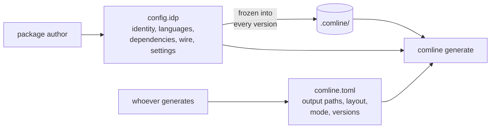

# Package files

A package (historically a *congregation*) has two configuration files with
different owners. Keeping them apart is what lets one package be generated
into many projects, each its own way.

| | [`config.idp`](config-id.md) | [`comline.toml`](comline-toml.md) |
|---|---|---|
| Owner | the package author | whoever runs `comline generate` |
| Says | what the package is: name, identity, languages it supports, dependencies, wire defaults, settings | where generated code goes, in what layout and mode, for which versions |
| Frozen into versions | yes | no |
| Changes the version | can | never |

The reasoning behind the split is in
[Consumer generation configuration](../../../design/consumer-generation-config.md).
How the version follows from changes is in [Versioning rules](../../versioning.md).
